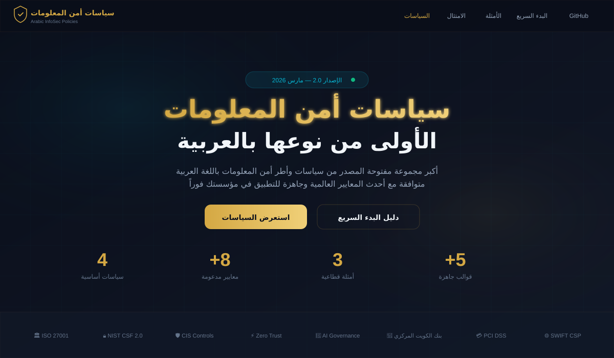
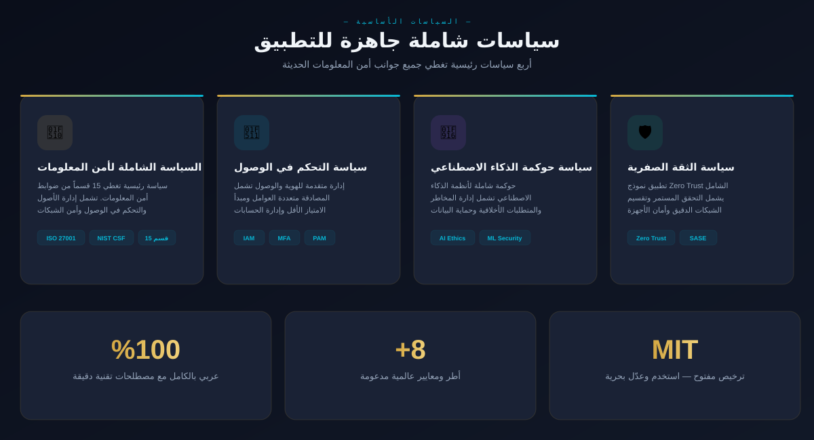
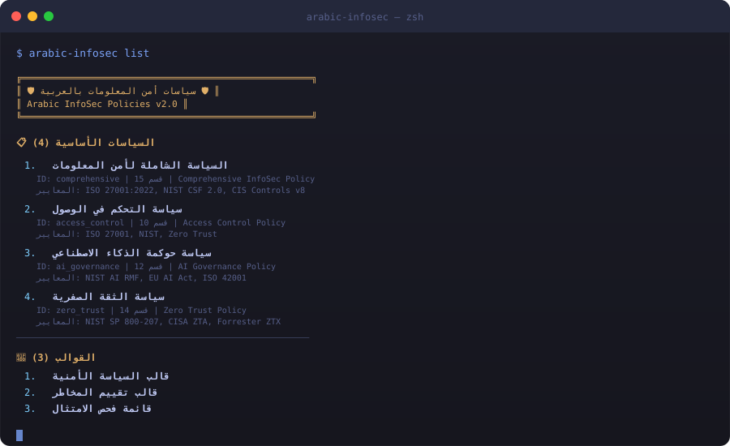

<div align="center">

# سياسات أمن المعلومات بالعربية

### Arabic Information Security Policies

**أكبر مجموعة مفتوحة المصدر من سياسات أمن المعلومات باللغة العربية**

[](LICENSE)
[](#)
[](#)
[](#)
[](CONTRIBUTING.md)
[](https://siteq8.github.io/arabic-infosec-policies)

<br>

[**🌐 الموقع التفاعلي**](https://siteq8.github.io/arabic-infosec-policies) · [**📋 السياسات**](#-السياسات-الأساسية) · [**🚀 البدء السريع**](#-البدء-السريع) · [**📦 npm**](#-التثبيت-عبر-npm) · [**🤝 المساهمة**](CONTRIBUTING.md)

<br>

</div>

---

## لقطات من الموقع التفاعلي

### الصفحة الرئيسية
<div align="center">

</div>

### استعراض السياسات
<div align="center">

</div>

### أداة سطر الأوامر (CLI)
<div align="center">

</div>

---

## نظرة عامة

مجموعة شاملة ومتكاملة من سياسات أمن المعلومات باللغة العربية، مصممة وفقاً لأحدث المعايير والأطر العالمية لعام 2025-2026. هذه السياسات قابلة للتخصيص والتطبيق الفوري في أي مؤسسة عربية، سواء كانت حكومية، مصرفية، صحية، أو خاصة.

### لماذا هذا المشروع؟

- **عربي 100%**: مصطلحات تقنية دقيقة ومراجعة لغوية شاملة
- **متوافق مع 8+ معايير**: ISO 27001, NIST, CIS, Zero Trust, وأكثر
- **مفتوح المصدر**: ترخيص MIT، استخدم وعدّل بحرية تامة
- **جاهز للتطبيق**: قوالب وأمثلة قطاعية جاهزة فوراً
- **يشمل حوكمة AI**: سياسة متقدمة لحوكمة الذكاء الاصطناعي
- **موقع تفاعلي**: استعرض وابحث عبر GitHub Pages
- **حزمة npm**: أداة CLI لإدارة السياسات برمجياً

---

## السياسات الأساسية

| # | السياسة | الوصف | المعايير |
|---|---------|-------|----------|
| 🔐 | [**السياسة الشاملة لأمن المعلومات**](./policies/comprehensive_infosec_policy.md) | 15 قسم يغطي جميع جوانب أمن المعلومات | ISO 27001, NIST CSF, CIS |
| 🔑 | [**سياسة التحكم في الوصول**](./policies/access_control_policy.md) | إدارة الهوية، MFA، الامتياز الأقل، PAM | ISO 27001, NIST, ZTA |
| 🤖 | [**سياسة حوكمة الذكاء الاصطناعي**](./policies/ai_governance_policy.md) | حوكمة AI، أخلاقيات، إدارة المخاطر | NIST AI RMF, EU AI Act |
| 🛡️ | [**سياسة الثقة الصفرية**](./policies/zero_trust_policy.md) | Zero Trust، تقسيم دقيق، SASE | NIST 800-207, CISA ZTA |

---

## مصفوفة الامتثال

| المعيار | التغطية | الحالة |
|---------|---------|--------|
| ISO/IEC 27001:2022 | █████████████████████ 100% | ✅ مكتملة |
| NIST CSF 2.0 | █████████████████████ 100% | ✅ مكتملة |
| CIS Controls v8 | ████████████████████░ 95% | ✅ مكتملة |
| Zero Trust Architecture | █████████████████████ 100% | ✅ مكتملة |
| AI Governance | █████████████████████ 100% | ✅ مكتملة |
| GDPR | ██████████████████░░░ 90% | ⚠️ جزئية |
| PCI DSS | █████████████░░░░░░░░ 65% | ⚠️ جزئية |
| بنك الكويت المركزي (CBK) | ████████████░░░░░░░░░ 60% | ⚠️ جزئية |
| SWIFT CSP | ██████░░░░░░░░░░░░░░░ 30% | ⚠️ جزئية |

---

## البدء السريع

### 1. الاستنساخ
```bash
git clone https://github.com/SiteQ8/arabic-infosec-policies.git
cd arabic-infosec-policies
```

### 2. التخصيص
```bash
# استبدل اسم المؤسسة في جميع الملفات
find policies/ -type f -name "*.md" \
  -exec sed -i 's/\[اسم المؤسسة\]/اسم شركتك/g' {} +
```

### 3. التطبيق
```
المرحلة 1 (الأسبوع 1-2): التقييم → مراجعة الوضع الحالي وتحديد الفجوات
المرحلة 2 (الأسبوع 3-4): التخصيص → تعديل السياسات ومراجعة الفريق القانوني
المرحلة 3 (الأسبوع 5-8): التطبيق → تدريب الموظفين والتطبيق المرحلي
```

---

## التثبيت عبر npm

```bash
# التثبيت عالمياً
npm install -g arabic-infosec-policies

# عرض جميع السياسات
arabic-infosec list

# فحص الامتثال
arabic-infosec audit

# فحص معيار محدد
arabic-infosec audit --standard iso27001

# تصدير سياسة
arabic-infosec export --policy comprehensive

# تخصيص السياسات لمؤسستك
arabic-infosec customize --org "اسم المؤسسة" --sector banking

# إحصائيات المستودع
arabic-infosec stats
```

### الاستخدام البرمجي
```javascript
const { getPolicy, listPolicies, customizePolicy } = require('arabic-infosec-policies');

// عرض جميع السياسات
const policies = listPolicies();

// قراءة سياسة معينة
const policy = getPolicy('comprehensive');
console.log(policy.content);

// تخصيص سياسة لمؤسستك
const customized = customizePolicy('comprehensive', {
  orgName: 'شركتي'
});
```

---

## الموقع التفاعلي

يمكنك تصفح جميع السياسات عبر الموقع التفاعلي المتاح على GitHub Pages:

**[https://siteq8.github.io/arabic-infosec-policies](https://siteq8.github.io/arabic-infosec-policies)**

يشمل الموقع:
- استعراض تفاعلي لجميع السياسات والقوالب
- بحث فوري في جميع المحتويات
- مصفوفة الامتثال التفاعلية
- دليل البدء السريع مع أمثلة كود
- تصميم حديث يدعم العربية (RTL) بالكامل

---

## هيكل المستودع

```
arabic-infosec-policies/
├── 🌐 index.html                    ← الموقع التفاعلي (GitHub Pages)
├── 📦 package.json                   ← حزمة npm
├── 📄 README.md
├── 📄 LICENSE
├── 📄 SECURITY.md
├── 📄 CONTRIBUTING.md
├── 📄 CODE_OF_CONDUCT.md
├── 📁 src/
│   ├── cli.js                        ← أداة سطر الأوامر
│   ├── index.js                      ← API البرمجي
│   └── test.js                       ← الاختبارات
├── 📁 policies/
│   ├── comprehensive_infosec_policy.md
│   ├── access_control_policy.md
│   ├── ai_governance_policy.md
│   └── zero_trust_policy.md
├── 📁 templates/
│   ├── policy_template.md
│   ├── risk_assessment_template.xlsx
│   └── compliance_checklist.md
├── 📁 docs/
│   ├── implementation_guide.md
│   ├── customization_guide.md
│   └── compliance_mapping.md
├── 📁 examples/
│   ├── banking_example.md
│   ├── healthcare_example.md
│   └── government_example.md
├── 📁 screenshots/
│   ├── hero.svg
│   ├── policies.svg
│   └── cli.svg
└── 📁 .github/
    └── workflows/
        └── ci.yml                    ← CI/CD + GitHub Pages
```

---

## أمثلة قطاعية

| القطاع | الملف | يشمل |
|--------|-------|------|
| 🏦 [المصرفي](./examples/banking_example.md) | `banking_example.md` | CBK, PCI DSS, SWIFT, حماية المعاملات |
| 🏥 [الصحي](./examples/healthcare_example.md) | `healthcare_example.md` | سجلات طبية، أجهزة متصلة، خصوصية |
| 🏛️ [الحكومي](./examples/government_example.md) | `government_example.md` | بنية تحتية، خدمات إلكترونية، بيانات سيادية |

---

## القوالب

| القالب | الوصف |
|--------|-------|
| [قالب السياسة الأمنية](./templates/policy_template.md) | قالب شامل لإنشاء سياسة أمنية جديدة |
| [قالب تقييم المخاطر](./templates/risk_assessment_template.xlsx) | جدول Excel لتقييم وتصنيف المخاطر |
| [قائمة فحص الامتثال](./templates/compliance_checklist.md) | قائمة تفصيلية للتحقق من الامتثال |

---

## الوثائق

| الوثيقة | الوصف |
|---------|-------|
| [دليل التطبيق](./docs/implementation_guide.md) | خطة مرحلية كاملة لتطبيق السياسات |
| [دليل التخصيص](./docs/customization_guide.md) | كيفية تعديل السياسات لمؤسستك |
| [خريطة الامتثال](./docs/compliance_mapping.md) | ربط السياسات بالمعايير العالمية |

---

## المساهمة

نرحب بمساهماتكم! راجع [دليل المساهمة](CONTRIBUTING.md) للتفاصيل.

```bash
# 1. Fork المستودع
# 2. أنشئ branch جديد
git checkout -b feature/اسم-الميزة

# 3. أضف تغييراتك
git commit -m "إضافة: وصف التغيير"

# 4. ارفع التغييرات
git push origin feature/اسم-الميزة

# 5. افتح Pull Request
```

### أنواع المساهمات المطلوبة:
- تحسينات على النصوص والمصطلحات التقنية
- إضافة أمثلة لقطاعات جديدة (تعليم، اتصالات، نفط وغاز)
- تحسين تغطية المعايير (CBK, PCI DSS, SWIFT)
- ترجمة الوثائق التكميلية
- تحسينات على الموقع التفاعلي وأداة CLI

---

## الأمان

للإبلاغ عن ثغرة أمنية، راجع [SECURITY.md](SECURITY.md).

---

## الترخيص

مرخص تحت [MIT License](LICENSE)، استخدم، عدّل، ووزّع بحرية تامة.

---

## التواصل

- **GitHub:** [@SiteQ8](https://github.com/SiteQ8)
- **البريد الإلكتروني:** site@hotmail.com
- **المشاكل التقنية:** [GitHub Issues](https://github.com/SiteQ8/arabic-infosec-policies/issues)

---

<div align="center">

**صنع بـ ❤️ في الكويت 🇰🇼**

بواسطة [AlEnezi (SiteQ8)](https://github.com/SiteQ8)

آخر تحديث: مارس 2026 | الإصدار: 2.0

</div>
